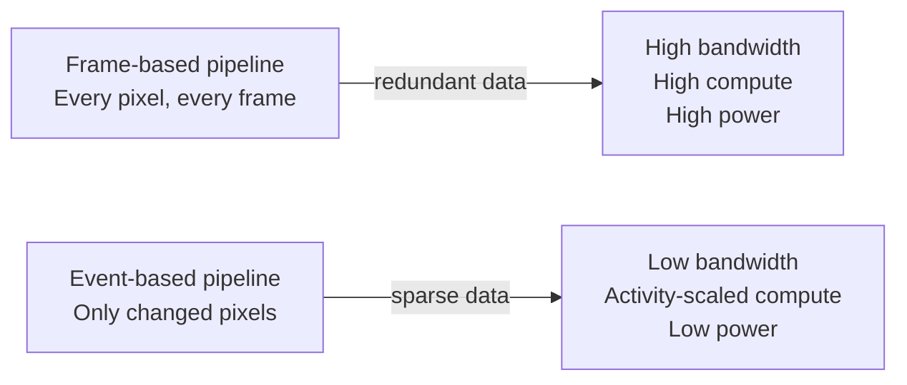
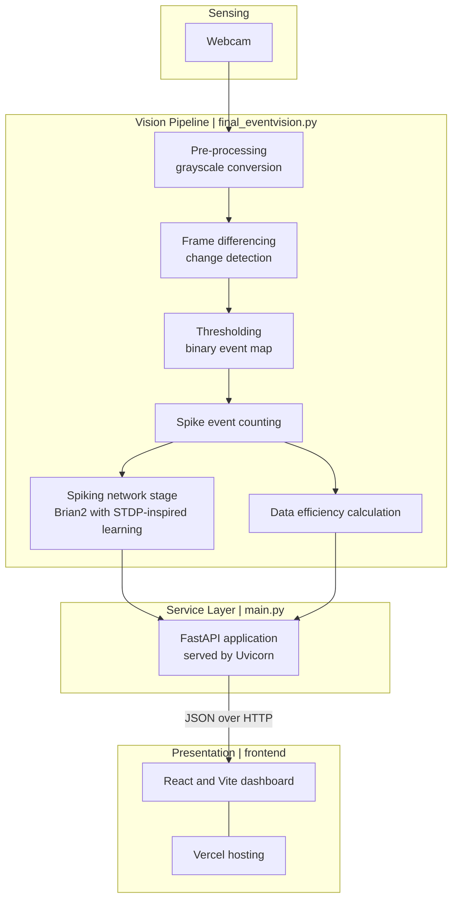
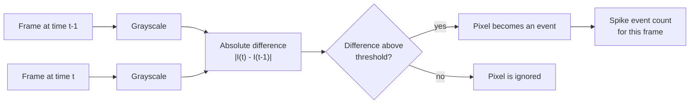
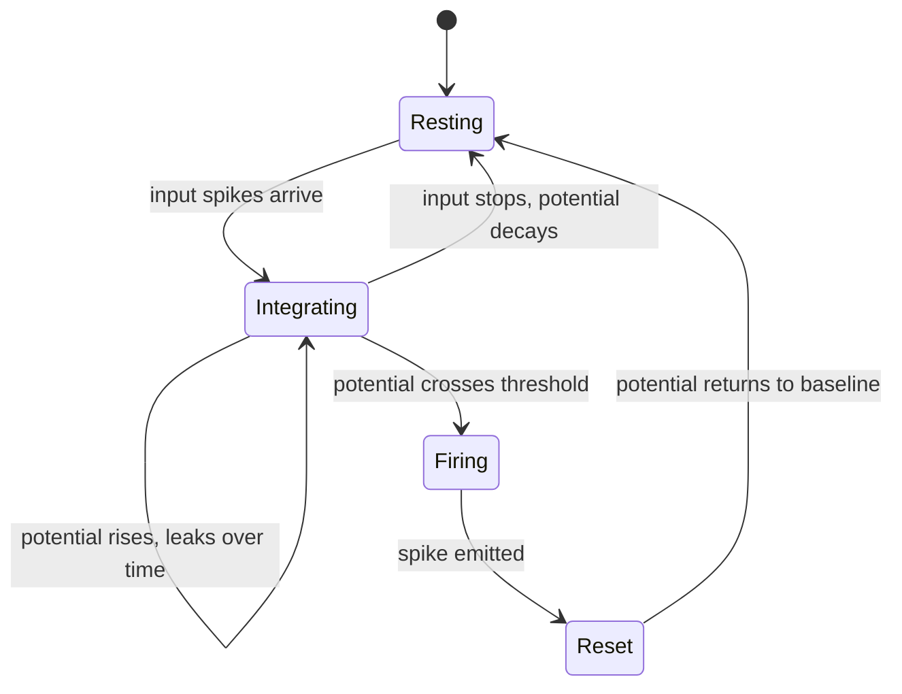
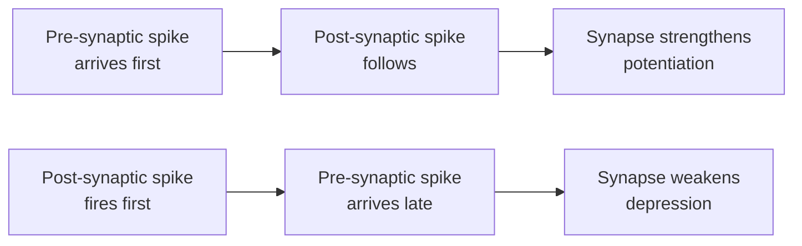
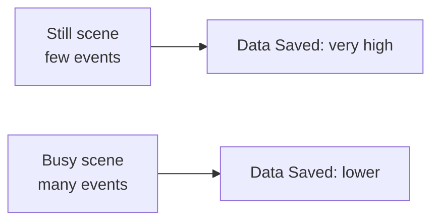
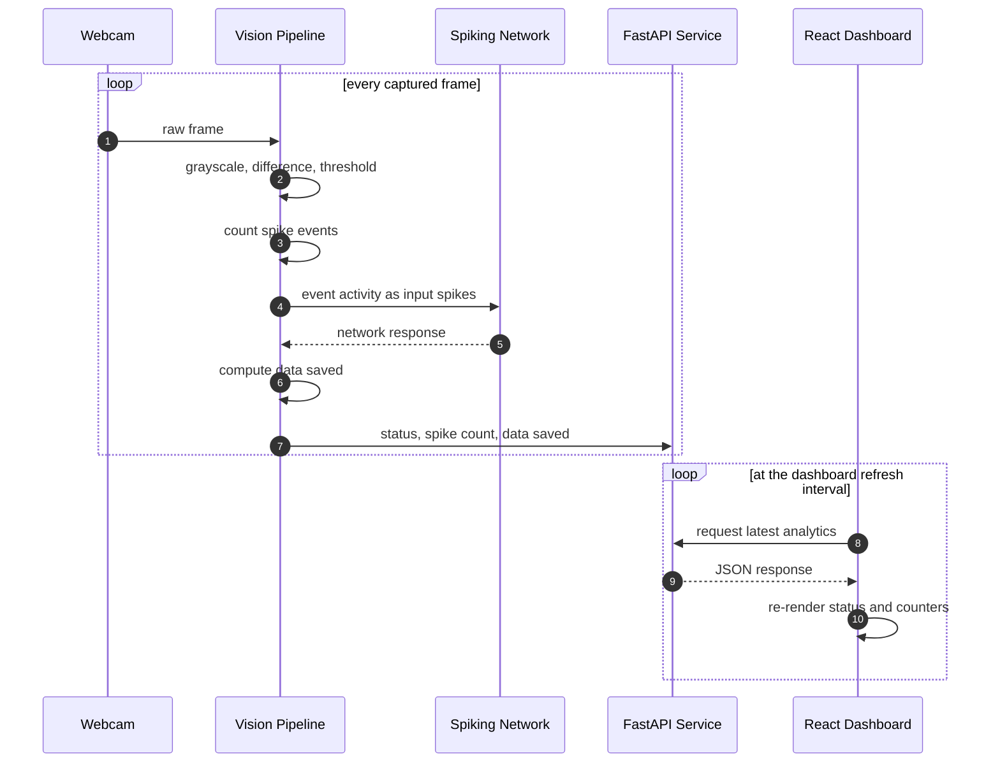
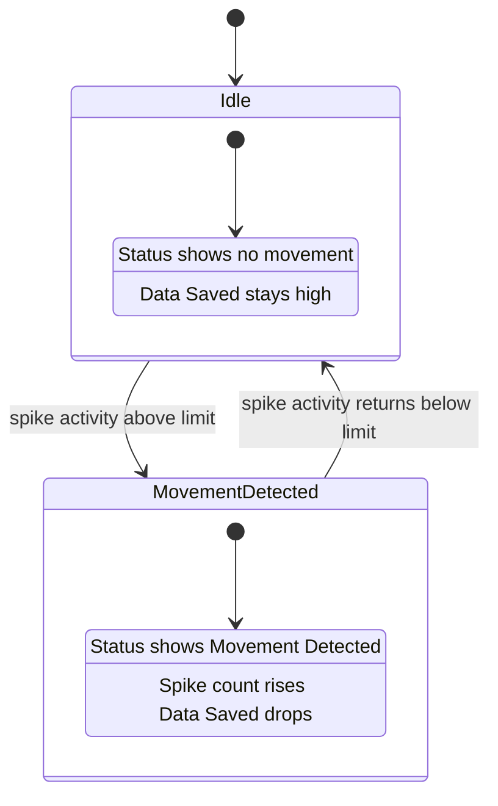
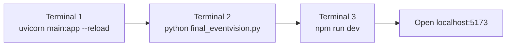
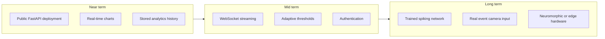

<div align="center">

```
█████  █   █  █████  █   █  █████
█      █   █  █      ██  █    █
████   █   █  ████   █ █ █    █
█       █ █   █      █  ██    █
█████    █    █████  █   █    █

█   █  █████   ████  █████   ███   █   █
█   █    █    █        █    █   █  ██  █
█   █    █     ███     █    █   █  █ █ █
 █ █     █        █    █    █   █  █  ██
  █    █████  ████   █████   ███   █   █

FRAME  ████████████████████████████████████████
       every pixel, every frame

EVENT  ·····██·········███············██·······
       only what changed
```

### Event-Driven Neuromorphic Video Analytics

*Process what changes. Ignore what doesn't.*

[Live Dashboard](https://frontend-7obzm9ald-aditi-s-projects2521.vercel.app) &nbsp;|&nbsp; [Demo Video](https://drive.google.com/drive/folders/1MEWAiQl5jBEz2UaAwv7V0oGpQl_1XJtA) &nbsp;|&nbsp; [Vercel Project](https://vercel.com/aditi-s-projects2521/frontend)

</div>

---

## Overview

EventVision is a real-time video analytics system built around one principle: a camera should report **change**, not **everything**.

A conventional camera records every pixel of every frame, even when the scene is perfectly still. EventVision takes the opposite approach. It converts an ordinary webcam feed into a sparse stream of **events**, where each event marks a pixel whose brightness changed. That stream is counted, passed through a spiking neural network pipeline built with Brian2, and published through a FastAPI service to a React dashboard that shows live movement status, spike counts, and how much data was saved.

The result is a complete, end-to-end prototype of event-based vision: sensing, processing, serving, and visualisation, all running on commodity hardware with nothing more than a laptop camera.

---

## Why Frame-Based Video Is Wasteful

Frame-based video pipelines are wasteful by design.

| Situation | What a frame camera does | Consequence |
| --- | --- | --- |
| Empty hallway, nothing moving | Stores and processes every pixel of every frame | Bandwidth, memory, and power spent on identical data |
| Small object moves in a large scene | Reprocesses the whole image to find a tiny change | Compute scales with image size, not with activity |
| Always-on monitoring on edge devices | Runs continuously at a fixed rate | Short battery life, thermal limits, high storage cost |

Biological vision does not work this way. The retina sends signals when something changes, and the brain spends energy only where there is activity. Neuromorphic engineering borrows this idea, and EventVision applies it to a practical video analytics workflow.

---

## Core Concept: Report Change, Not Everything



Three ideas are combined in this project:

- **Event generation.** Consecutive frames are compared, and only pixels that changed beyond a threshold produce events.
- **Spike-based processing.** Event activity is treated as input spikes for a spiking neural network, whose neurons integrate activity over time instead of reacting frame by frame.
- **Live observability.** Every stage reports into an API, so the behaviour of the system can be watched in real time from a browser.

---

## System Architecture and Data Flow

EventVision is split into two cooperating halves: a **vision pipeline** that touches the camera, and a **service and dashboard layer** that exposes results to the user. They are deliberately decoupled, so either side can be replaced without touching the other.



### Layer Responsibilities

| Layer | Component | Responsibility |
| --- | --- | --- |
| Sensing | Webcam via OpenCV | Supplies raw frames |
| Vision | `final_eventvision.py` | Generates events, counts spikes, runs the SNN stage, computes efficiency |
| Service | `main.py` (FastAPI) | Receives and serves the latest analytics as JSON |
| Presentation | React and Vite app | Polls the API and renders status, spike count, and data saved |
| Hosting | Vercel | Serves the built frontend |

---

## Event Generation: From Camera Frames to Sparse Events

A real event camera, such as a dynamic vision sensor, has pixels that fire independently the moment their brightness changes. A webcam cannot do that, so EventVision **emulates** the behaviour in software.



### Why Differencing Tracks Activity

Where nothing moves, the difference between two frames is close to zero, so almost no pixels pass the threshold and almost no events are produced. Where something moves, brightness changes at its edges, and those pixels generate events. Event count therefore tracks **activity**, not image size.

### Anatomy of an Event

A hardware event camera reports each event as a tuple of four values. EventVision keeps the same mental model, even though its timestamps come from frame timing rather than from the sensor.

| Field | Meaning | Real DVS sensor | EventVision |
| --- | --- | --- | --- |
| x, y | Pixel location | Yes | Yes |
| t | Timestamp | Microsecond precision | Frame-rate precision |
| p | Polarity (brighter or darker) | Yes | Depends on whether the signed difference is retained |

---

## Neuromorphic Processing: The Spiking Network Stage

After event counting, activity is passed to a spiking neural network (SNN) simulated with **Brian2**.

### Why Spikes Instead of Continuous Values

A standard neural network passes continuous numbers forward in one sweep. A spiking network behaves more like biological tissue: each neuron holds a **membrane potential** that builds as input arrives, slowly **leaks** back toward rest, and **fires a spike** when it crosses a threshold. Information lives in the *timing and rate* of spikes.



The standard model for this behaviour is the leaky integrate-and-fire neuron:

```
tau * dv/dt = -(v - v_rest) + I
```

where `v` is the membrane potential, `tau` controls how quickly it leaks, and `I` is the incoming drive.

### Unsupervised Learning with STDP

The learning idea in this project is inspired by **Spike-Timing-Dependent Plasticity**. It is an unsupervised, local rule: a synapse strengthens when the sending neuron fires shortly before the receiving neuron, and weakens when the order is reversed.



> The STDP component is a demonstration of the mechanism within the pipeline. It is not trained against a labelled task. See the Engineering Decisions and Known Limitations section.

---

## Data Efficiency Metric

The dashboard reports a **Data Saved** percentage. It answers a simple question: of all the pixels in a frame, how many did the system *not* need to process?

```
Data Saved (%) = ( 1 - changed_pixels / total_pixels ) x 100
```

### Worked Calculation

| Quantity | Value |
| --- | --- |
| Frame resolution | 640 x 480 |
| Total pixels | 307,200 |
| Pixels that changed | 6,000 |
| Fraction active | 1.95% |
| **Data saved** | **about 98%** |



### Interpreting the Metric

- The metric reflects **downstream processing savings**. The webcam still captures full frames, so sensor-level savings only exist on true event hardware.
- Each real event also carries coordinates and a timestamp, so savings measured in bytes are smaller than savings measured in pixels.
- The figure depends heavily on the scene. A static room scores high; a crowded street scores low.

---

## Runtime Behaviour: One Update Cycle

The sequence below shows what happens during a single update cycle while the system is running.



### Movement Status Logic



---

## Live Monitoring Dashboard

The React dashboard is intentionally focused. It presents three readings, updated continuously.

| Reading | What it tells you |
| --- | --- |
| **Status** | Whether movement is currently detected |
| **Spike Events** | How many events the latest frame produced |
| **Data Saved** | The percentage of pixel data that did not need processing |

Illustrative output:

```
Status          Movement Detected
Spike Events    4,812
Data Saved      98.4%
```

---

## Repository Layout

```
Event_Vision
|
|-- backend
|   |-- main.py                  FastAPI application
|   |-- final_eventvision.py     Vision, event, and SNN pipeline
|   `-- (supporting modules)
|
|-- frontend
|   |-- src                      React components and styles
|   |-- package.json             Dependencies and scripts
|   `-- (Vite configuration)
|
|-- README.md
`-- .gitignore
```

---

## Technology Stack and Rationale

| Area | Technology | Why it was chosen |
| --- | --- | --- |
| Language | Python | Strongest ecosystem for vision and scientific computing |
| Capture and vision | OpenCV | Reliable camera access and fast image operations |
| Numerics | NumPy | Vectorised array math; OpenCV frames are NumPy arrays |
| Spiking networks | Brian2 | Equation-based neuron definitions with built-in plasticity support |
| API | FastAPI | Async, typed, with automatic interactive documentation |
| Server | Uvicorn | Lightweight ASGI server with hot reload for development |
| HTTP client | requests | Simple transport between the vision loop and the API |
| Frontend | React | Component-driven UI that re-renders on state change |
| Build tool | Vite | Near-instant dev server and fast production builds |
| Hosting | Vercel | Automatic deployment from GitHub |
| Source control | GitHub | History, collaboration, and deployment trigger |

---

## Installation and Execution

### Requirements

- Python 3.9 or newer
- Node.js 18 or newer
- A working webcam

### Step 1: Obtain the Source

```bash
git clone <your-repository-url>
cd Event_Vision
```

### Step 2: Launch the Backend

```bash
cd backend
pip install opencv-python numpy brian2 fastapi uvicorn requests
```

Start the API service:

```bash
uvicorn main:app --reload
```

In a second terminal, start the vision pipeline:

```bash
python final_eventvision.py
```

The API runs on `http://127.0.0.1:8000` by default. FastAPI also serves interactive documentation at `/docs`.

### Step 3: Launch the Dashboard

```bash
cd frontend
npm install
npm run dev
```

Open `http://localhost:5173/` in a browser.

### Startup Sequence



### Common Issues and Resolutions

| Symptom | Likely cause | Fix |
| --- | --- | --- |
| Dashboard shows no live data | API or vision script is not running | Start both backend processes before opening the dashboard |
| Camera window does not open | Camera in use by another application, or wrong device index | Close other camera apps and check the capture index |
| Hosted dashboard shows no live data | Backend runs locally and is not publicly reachable | Run everything on one machine, or expose the API through a tunnel |
| Browser reports a cross-origin error | API does not allow the dashboard origin | Allow the frontend origin in the API CORS configuration |

---

## Demonstration

A recorded walkthrough of the system running end to end:

https://github.com/user-attachments/assets/c824674b-5096-4c3d-aeec-f907ba39ad3a

Additional video explanation: [Google Drive folder](https://drive.google.com/drive/folders/1MEWAiQl5jBEz2UaAwv7V0oGpQl_1XJtA)

### Recommended Demonstration Script

1. Start the API, the vision pipeline, and the dashboard.
2. Stay still in front of the camera. Status shows no movement and Data Saved is high.
3. Wave a hand. Status changes to Movement Detected, spike count jumps, and Data Saved drops.
4. Stay still again and watch the readings settle.

---

## Engineering Decisions and Known Limitations

A prototype is more useful when it states clearly what it does and does not do.

### Architectural Choices

| Decision | Reason |
| --- | --- |
| Vision pipeline and API are separate processes | The camera loop is long-running and hardware-bound; the API should stay responsive and replaceable |
| Frontend is independent of the backend | The UI can be redeployed on its own, and the API can serve other clients later |
| Backend is not hosted on Vercel | It needs direct webcam access and a continuously running process, which serverless functions do not provide |

### Comparison with Hardware Event Cameras

| Property | Hardware event camera | EventVision |
| --- | --- | --- |
| Event source | Each pixel fires independently | Software comparison of consecutive frames |
| Timing | Asynchronous, microsecond resolution | Bound by webcam frame rate |
| Data reduction | At the sensor | After conversion, in processing |
| Dynamic range | Very high | Limited by the webcam |

### Current Constraints

- Events are emulated from a standard webcam, so the system is event-like rather than truly asynchronous.
- The spiking network is a demonstration of the workflow. It is not trained on a labelled task and does not run on neuromorphic hardware.
- Frame differencing is sensitive to lighting changes, auto-exposure shifts, camera shake, and sensor noise.
- The system detects that motion occurred, not what moved. It performs no classification or tracking.
- The FastAPI backend is not yet publicly deployed, so the hosted dashboard cannot show live data on its own.
- No authentication or stored history is implemented.

---

## Roadmap and Future Work



| Horizon | Item | Benefit |
| --- | --- | --- |
| Near term | Public backend deployment | Hosted dashboard shows live data |
| Near term | Real-time graphs and history | Trends become visible, not just the latest value |
| Mid term | WebSockets in place of polling | Lower latency and less request overhead |
| Mid term | Adaptive thresholding | Fewer false events under changing light |
| Mid term | User authentication | Safe access to camera-derived data |
| Long term | Better SNN training | Learned recognition instead of activity counting |
| Long term | Event camera hardware support | True asynchronous events with microsecond timing |

---

## Glossary of Terms

| Term | Definition |
| --- | --- |
| Event | A pixel whose brightness changed beyond a threshold |
| Spike | A discrete signal emitted when a neuron's potential crosses its threshold |
| Neuromorphic | Modelled on how biological nervous systems compute, using spikes and event-driven activity |
| SNN | Spiking neural network, a network whose neurons communicate through spikes over time |
| LIF | Leaky integrate-and-fire, a standard simple spiking neuron model |
| STDP | Spike-timing-dependent plasticity, a learning rule driven by relative spike timing |
| DVS | Dynamic vision sensor, a camera whose pixels report brightness changes independently |
| Frame differencing | Subtracting one frame from the next to find what changed |
| Data Saved | Share of pixels that did not need processing in a given frame |

---

## Contributor


| Name | |  |
| --- | --- |
| Aditi Sharma | CSE ( Cyber security and digital forensics) |

---

<div align="center">

**EventVision**
Event-Driven Neuromorphic Video Analytics

</div>
